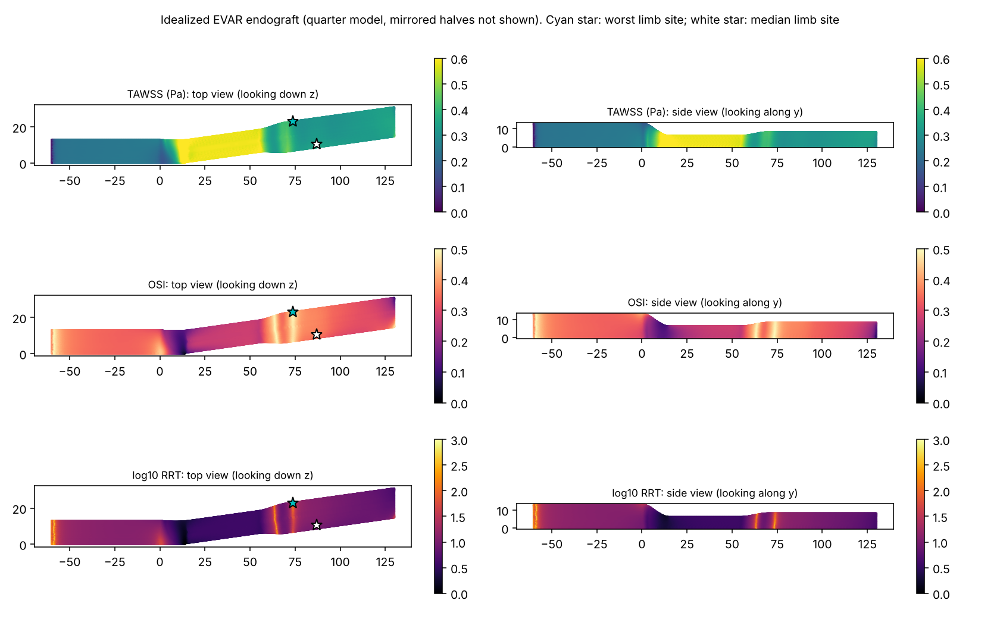
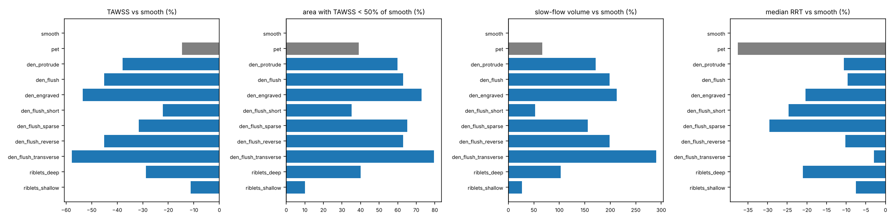

# DentiFlow EVAR results (computational)

Generated by `evar/summary.py` from the result files. Mesh: coarse vessel-scale preset; patch at 3 um. **Preliminary until the digitised waveform replaces the generic one.**

## 1. Method check: Womersley validation (25 mm tube, Newtonian)

| Quantity | CFD | Analytical |
|---|---|---|
| TAWSS (Pa) | 0.1914 | 0.1869 |
| OSI | 0.4112 | 0.4085 |
| Peak WSS (Pa) | 0.9704 | 0.9717 |
| RMS error over the cycle | 1.05% of peak | |

## 2. Vessel scale: idealized bifurcated endograft (resting infrarenal flow)

| Segment | TAWSS (Pa) | area < 0.4 Pa | OSI | area OSI > 0.25 | RRT median (1/Pa) | RRT 95th pct |
|---|---|---|---|---|---|---|
| whole_graft (excl. outlet zone) | 0.3718 | 69.56% | 0.3233 | 88.61% | 10.594 | 32.174 |
| body | 0.2333 | 100.0% | 0.3546 | 100.0% | 13.287 | 48.487 |
| bifurcation | 0.461 | 49.44% | 0.2216 | 34.02% | 3.775 | 21.554 |
| bifurcation_inner | 0.66 | 15.45% | 0.1567 | 11.13% | 2.597 | 7.145 |
| bifurcation_outer | 0.4614 | 44.83% | 0.2011 | 19.08% | 3.482 | 18.274 |
| leg | 0.5876 | 0.0% | 0.2641 | 84.4% | 3.7 | 3.868 |
| leg_inner | 0.5897 | 0.0% | 0.264 | 82.9% | 3.705 | 3.869 |
| leg_outer | 0.5855 | 0.0% | 0.2641 | 85.89% | 3.697 | 3.867 |
| flare | 0.4088 | 51.55% | 0.3782 | 100.0% | 9.735 | 81.179 |
| flare_inner | 0.4153 | 50.35% | 0.379 | 100.0% | 9.914 | 81.202 |
| flare_outer | 0.4025 | 52.72% | 0.3774 | 100.0% | 9.513 | 80.865 |
| limb | 0.3322 | 94.3% | 0.3546 | 100.0% | 9.998 | 31.479 |
| limb_inner | 0.3412 | 92.8% | 0.3484 | 100.0% | 9.322 | 26.973 |
| limb_outer | 0.3232 | 95.79% | 0.3608 | 100.0% | 10.966 | 37.263 |

Patch sites (2 mm neighbourhood averages):

- **worst limb site**: x = 73.88 mm (limb, outer wall), TAWSS 0.3457 Pa, OSI 0.4721, RRT 103.17 1/Pa; cross-flow 0.5% of the principal component (RMS)
- **median limb site**: x = 86.87 mm (limb, inner wall), TAWSS 0.3486 Pa, OSI 0.3575, RRT 10.074 1/Pa; cross-flow 5.1% of the principal component (RMS)

Cycle-to-cycle change of probe TAWSS (last two cycles): max 0.1%.

## 3. Texture scale: wall patch at the worst limb site

Site waveform: TAWSS 0.341 Pa, OSI 0.497.

| Design | TAWSS (Pa) | vs smooth | area < 50% smooth TAWSS | OSI | RRT median | WSSG p95 (Pa/mm) | slow-flow vol (um) | vs smooth | wetted area |
|---|---|---|---|---|---|---|---|---|---|
| smooth | 0.341 | 0.0% | 0.0% | 0.497 | 545.5 | 0.0 | 5.2 | 0.0% | 1.00 |
| pet | 0.291 | -14.6% | 39.02% | 0.490 | 340.5 | 12.3 | 8.6 | 66.3% | 1.06 |
| den_protrude | 0.212 | -37.9% | 59.94% | 0.487 | 487.8 | 72.6 | 14.0 | 171.2% | 1.71 |
| den_flush | 0.187 | -45.1% | 62.87% | 0.486 | 493.0 | 62.9 | 15.4 | 198.3% | 1.71 |
| den_engraved | 0.159 | -53.4% | 72.81% | 0.475 | 434.1 | 86.4 | 16.2 | 212.4% | 1.71 |
| den_flush_short | 0.266 | -22.1% | 35.2% | 0.492 | 410.7 | 51.9 | 7.9 | 52.8% | 1.21 |
| den_flush_sparse | 0.233 | -31.6% | 65.08% | 0.489 | 384.8 | 58.6 | 13.2 | 156.1% | 1.29 |
| den_flush_reverse | 0.187 | -45.1% | 62.87% | 0.486 | 490.1 | 62.8 | 15.4 | 198.5% | 1.71 |
| den_flush_transverse | 0.144 | -57.8% | 79.59% | 0.484 | 529.7 | 103.8 | 20.2 | 289.9% | 1.49 |
| riblets_deep | 0.243 | -28.8% | 40.0% | 0.492 | 430.9 | 94.7 | 10.5 | 102.7% | 1.41 |
| riblets_shallow | 0.303 | -11.2% | 10.0% | 0.496 | 504.7 | 57.7 | 6.6 | 26.7% | 1.12 |

Slow-flow volume is the fluid layer per unit graft area moving slower than fluid 5 um above a smooth wall (smooth = 5 um by construction).

Mesh check (den_flush, gamma = 25 1/s, 3 um vs 2 um cells): mean |WSS| +4.2%, slow-flow volume -0.2%. The default mesh slightly over-predicts textured-wall stress, so the TAWSS penalties above are if anything understated.

Quasi-steady check (exact unsteady 1D Carreau Couette solve of the patch gap vs the quasi-steady stress the patch model uses):

- worst site: RMS error 2.91% of peak; TAWSS 0.3406 vs 0.3408 Pa (-0.06%); OSI 0.497 vs 0.497
- median site: RMS error 2.51% of peak; TAWSS 0.3387 vs 0.3387 Pa (-0.02%); OSI 0.356 vs 0.356

## 4. Platelet deposition on the reactive graft surface

20.0 s of real time, 3 seeds per design, mean +/- SD across seeds.

Primary metric: deposition rate in the second half of the run (after the start-up transient).

| Design | late rate (/mm2/s) | vs smooth | z vs smooth | total deposited / mm2 | vs smooth | adhered / mm2 wetted | aggregated / mm2 | % in lowest third of texture |
|---|---|---|---|---|---|---|---|---|
| smooth | 339.74 +/- 10.19 | 0.0% | 0.0 | 9978.2 +/- 193.4 | 0.0% | 8334.0 | 1644.2 |  |
| pet | 606.04 +/- 21.4 | 78.4% | 19.46 | 14375.0 +/- 562.1 | 44.1% | 9882.2 | 3866.7 | 18.3 |
| den_protrude | 579.36 +/- 5.35 | 70.5% | 36.06 | 15822.8 +/- 177.0 | 58.6% | 7034.5 | 3668.3 | 18.8 |
| den_flush | 316.76 +/- 7.42 | -6.8% | -3.16 | 11728.5 +/- 243.8 | 17.5% | 5627.5 | 2005.1 | 23.5 |
| den_engraved | 326.56 +/- 5.7 | -3.9% | -1.96 | 11694.7 +/- 340.5 | 17.2% | 5501.2 | 2189.5 | 5.6 |
| den_flush_short | 313.49 +/- 2.66 | -7.7% | -4.32 | 10225.3 +/- 305.7 | 2.5% | 6929.4 | 1810.2 | 27.6 |
| den_flush_sparse | 328.7 +/- 13.32 | -3.2% | -1.14 | 10946.3 +/- 197.4 | 9.7% | 6722.8 | 2107.4 | 50.2 |
| den_flush_reverse | 316.18 +/- 9.27 | -6.9% | -2.96 | 11556.9 +/- 415.2 | 15.8% | 5537.0 | 1990.0 | 24.9 |
| den_flush_transverse | 350.71 +/- 8.04 | 3.2% | 1.46 | 11651.8 +/- 150.3 | 16.8% | 6234.4 | 2266.8 | 36.0 |
| riblets_deep | 332.52 +/- 7.43 | -2.1% | -0.99 | 10866.0 +/- 252.4 | 8.9% | 6558.3 | 1742.9 | 19.4 |
| riblets_shallow | 320.81 +/- 4.33 | -5.6% | -2.96 | 10013.6 +/- 135.8 | 0.4% | 7605.9 | 1561.8 | 26.5 |

Sensitivity: reservoir measured from the texture crest instead of the nominal surface (changes only the protruding designs; flush/engraved/riblet crests are at the nominal surface):

| Design | late rate (/mm2/s) | vs smooth | z vs smooth |
|---|---|---|---|
| smooth | 339.74 +/- 10.19 | 0.0% | 0.0 |
| pet | 327.5 +/- 20.32 | -3.6% | -0.93 |
| den_protrude | 338.93 +/- 12.39 | -0.2% | -0.09 |

