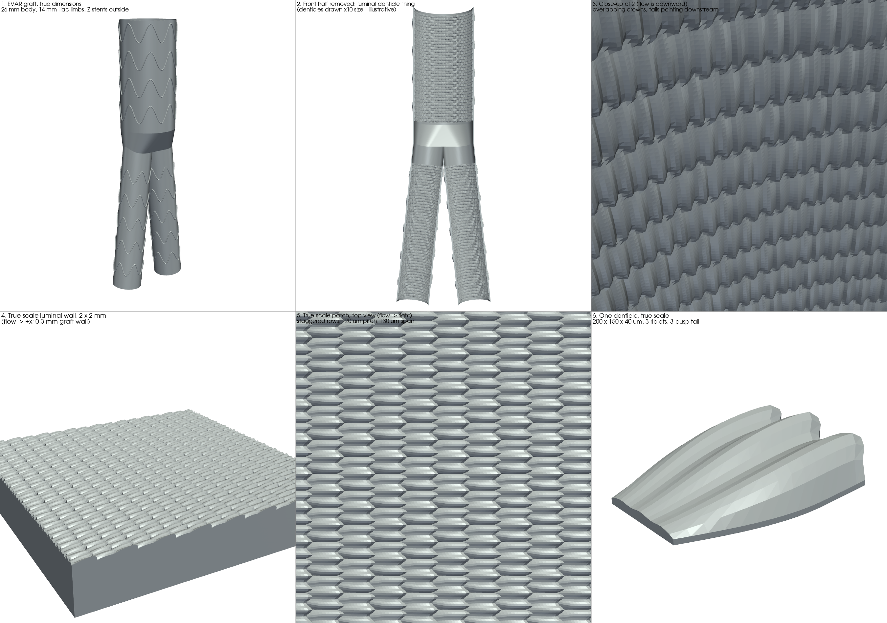

# EVAR graft with an overlapping shark-denticle lining

This folder holds a parametric CAD concept: a bifurcated abdominal-aortic EVAR stent graft whose **luminal (blood-contacting) surface** is covered in **imbricated (overlapping) shark denticles**. All files are in mm. Regenerate everything with:

```bash
python3 evar_graft/build_evar_graft.py
```

This takes about 15 s. It needs `numpy`, `trimesh`, `manifold3d` and `matplotlib`, plus `pyvista` for `preview.png`.



## Files

| File | What it is | Scale |
|---|---|---|
| `evar_graft_cutaway_illustrative.stl` | Whole graft with the front half removed, showing the denticle lining inside. **Denticles drawn 10× real size** so they are visible at device scale. | Graft true, texture ×10 |
| `evar_graft_smooth.stl` | Whole graft, closed, no texture. Use it for flow modelling as the untextured control. | True |
| `denticle_patch_true_scale.stl` | 2 × 2 mm piece of graft wall (0.3 mm) with the real-size texture. This is the actual design. | True |
| `denticle_unit_true_scale.stl` | One denticle. | True |
| `build_evar_graft.py` | The generator. All dimensions are dataclass fields at the top (`Denticle`, `Graft`). | |

At real size the lining is about **590,000 denticles**. That is far too many to put on a whole-device mesh, so the full graft is shown with enlarged denticles and the true-scale design is carried by the patch.

## Design

**Graft.** A generic bifurcated main body, not modelled on any commercial device:
- main body Ø26 mm × 50 mm, sized for a ~22–23 mm infrarenal neck at ~15% oversizing
- 10 mm taper to two Ø14 mm iliac limbs, each 70 mm long and diverging 6°
- 0.3 mm fabric wall
- Ø0.5 mm external sinusoidal Z-stents: 4 rings on the body, 5 on each limb

The stents are on the **outside** so the lumen is free for the texture. The flow divider and taper are left **untextured**.

**Denticle** (`Denticle` defaults):

| Parameter | Value | Why |
|---|---|---|
| Crown length × width | 200 × 150 µm | Within the real range for fast sharks (roughly 100–500 µm). The coronary design was limited to 100 µm by the strut width; a graft has continuous wall, so no such limit applies. |
| Height (trailing edge) | 40 µm, inclined: leading edge at 12% of height | The crown rises downstream, like a roof tile. |
| Riblets | 3, groove depth 35% of local height, ≈50 µm spacing | Run parallel to the flow. |
| Trailing edge | 3 cusps | Like a mako-type crown. |
| Row pitch (streamwise) | 120 µm, versus 200 µm length | **40% overlap**: each crown's raised tail sits over the low leading edge of the next row. |
| Row stagger | Alternate rows shifted half a span pitch | Tails land between two downstream crowns, as in shark skin. |
| Span pitch | 130 µm, versus 150 µm width | 13% lateral overlap, so no bare wall shows between crowns. |
| Orientation | Tails point downstream (proximal → iliac) | |

**Moldable by design.** Real denticles sit on a pedicel and overhang the skin. These crowns are **solid down to the wall**, with no undercuts. That means the texture can be released from a mold or imprinted, which is the Phase 3 method. The overlap is a stepped, shingled surface, not a cantilever.

## Caveats

1. **This changes the project's vessel.** Every other model, and the whole `cfd/` pipeline, is for a Ø3.2 mm coronary stent (see `PROJECT_SUMMARY.md`, issue 2). None of the coronary CFD or platelet results transfer to the infrarenal aorta:
   - peak Re there is ~1000–4000, versus ~200 coronary
   - flow reverses in diastole
   - the vessel is about 8× larger

   The `cfd/` pipeline is hard-coded to the coronary geometry and cannot run this graft as-is.
2. **PLGA is the wrong material for this.** PLGA is biodegradable, so a PLGA texture on a permanent EVAR graft would be gone within months. A durable graft would need a non-degrading textured luminal film, such as polyurethane or ePTFE. PLGA is still fine for the flat bench coupons.
3. **Texture on fabric is a manufacturing problem.** Real EVAR grafts are woven polyester or ePTFE, about 0.1–0.3 mm thick. Their weave roughness is on the same order as a 40 µm feature. Modelled here as a smooth 0.3 mm wall.
4. **The whole-graft cutaway is not to scale.** It uses a 0.1 mm height-field, so crown edges are softened. Quote dimensions from the true-scale patch only.
5. **No performance claim.** Whether this texture reduces platelet adhesion in aortic flow has not been tested here.
6. **The files are meshes (STL), not native CAD bodies.** SolidWorks or Fusion will import them as mesh bodies; to change dimensions, edit the script.
